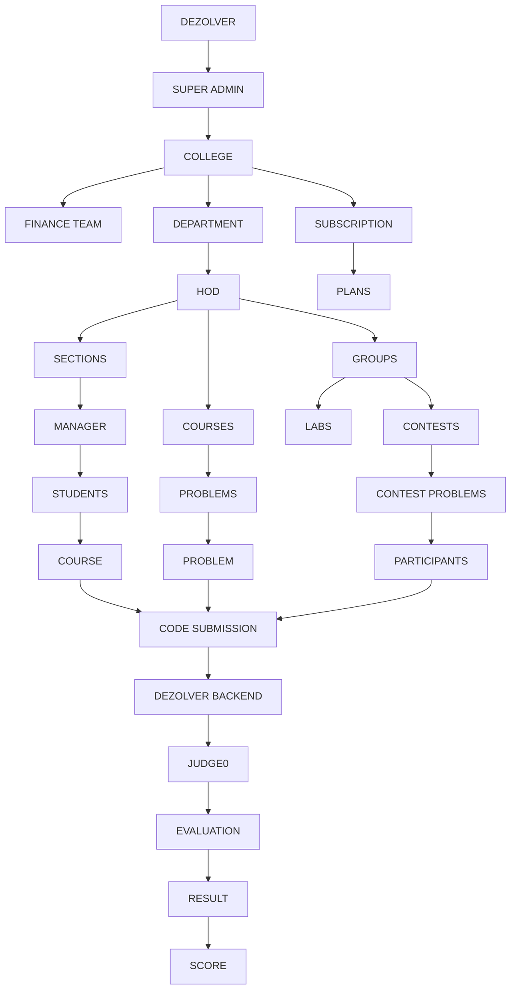
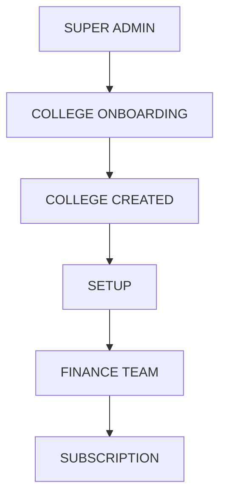
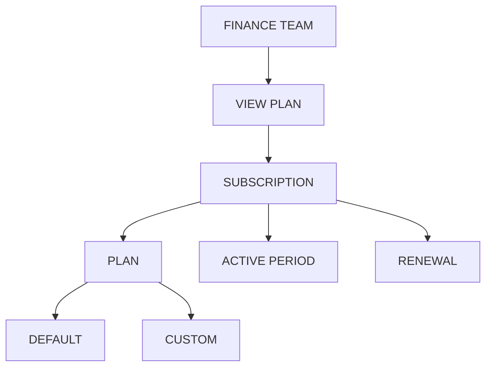
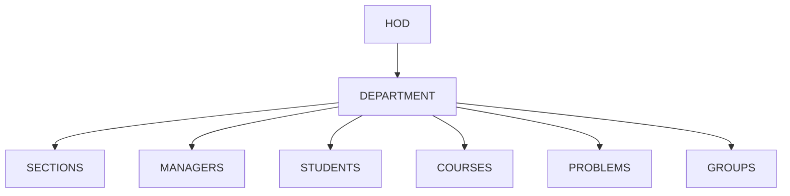
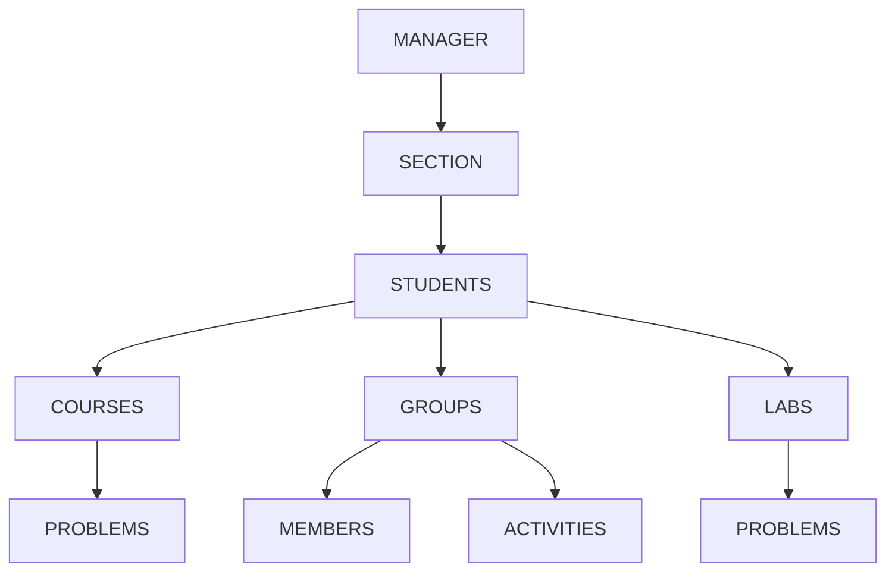
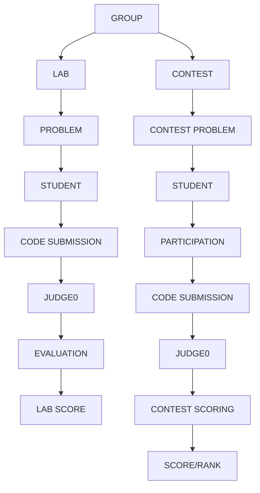
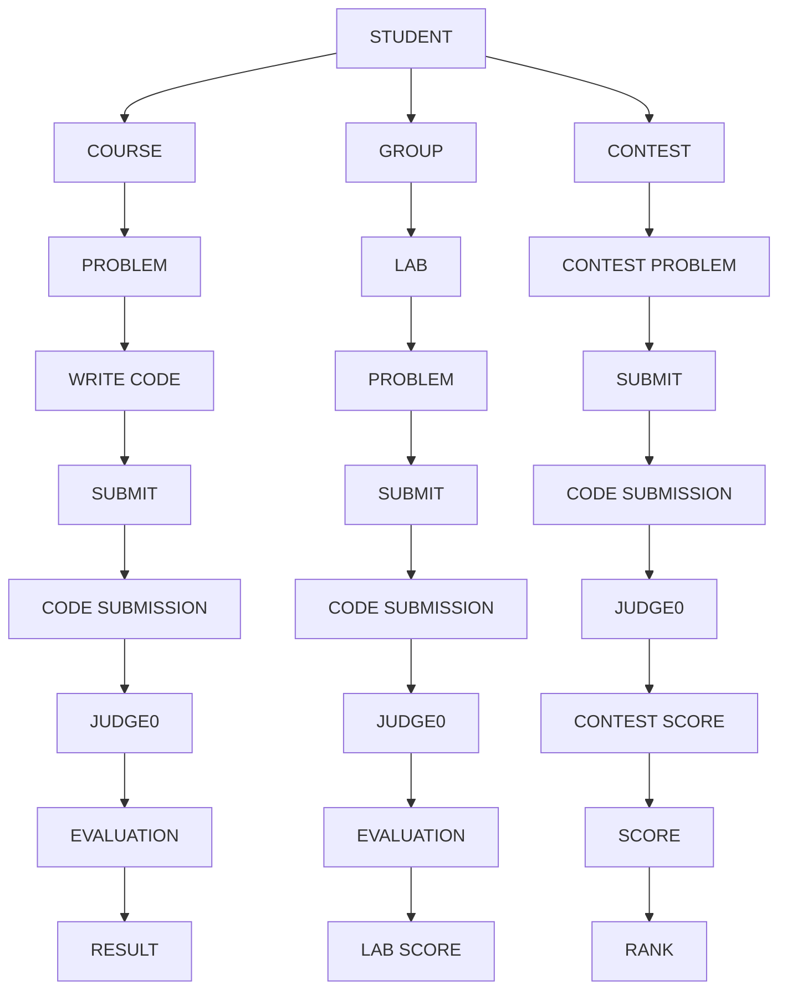

# Business Flow Diagrams - v2

This document provides Business Flow Diagrams for the DEZOLVER platform, illustrating the end-to-end workflow followed by each stakeholder. It explains how the Super Admin, Finance Team, HOD, Manager, and Student interact with the platform and how their activities flow from one stage to another. The document gives new developers a clear understanding of the overall business workflow, stakeholder responsibilities, and interactions before they begin working on the system.

## Original page 1 - Overall System Flow Diagram

## Original page 2 - Super Admin and Finance Team

### SUPER ADMIN

The Super Admin manages colleges at the platform level and starts the college onboarding process.

### FINANCE TEAM

The Finance Team handles the college's subscription and plan-related administration.

## Original page 3 - HOD and Manager

### HOD

The HOD manages the academic structure of the department and oversees the managers, sections and academic activities under the department.

### MANAGER

A Manager manages only the students and activities within their assigned section.

## Original page 4 - Groups + Labs + Contests

Groups act as the mediator for collaborative activities such as labs and contests.

## Original page 5 - Student

