# DEZOLVER Database Schema

> Markdown reconstruction of `scheema.pdf` from the DEZOLVER Google Drive folder.
> The source PDF is primarily an ER/schema diagram, so this Markdown version preserves the entities, fields, data types, named relationships, and enums in a searchable format.

## Entity Relationship Overview

```mermaid
erDiagram
    College ||--o{ Department : college_has_departments
    Department ||--o{ Section : department_has_sections
    User ||--o{ RefreshSession : user_has_refresh_sessions
    User ||--o{ AuditLog : user_creates_audit_logs
    Plan ||--o{ PricingQuote : plan_has_pricing_quotes
    CollegeOnboarding ||--o{ PricingQuote : onboarding_has_pricing_quotes
    User ||--o{ PricingQuote : user_creates_pricing_quotes
    User ||--o{ CollegeOnboarding : user_reviews_college_onboarding
    PricingQuote ||--o{ PaymentTransaction : pricing_quote_has_payment_transactions
    Plan ||--o{ Subscription : plan_has_subscriptions
    College ||--o{ Subscription : college_has_subscriptions
    Subscription ||--o{ Invoice : subscription_has_invoices
    College ||--o{ Invoice : college_has_invoices
    Subscription ||--o{ PaymentTransaction : subscription_has_payments
    College ||--o{ PaymentTransaction : college_has_payments
    College ||--o{ Course : college_has_courses
    Department ||--o{ Course : department_offers_courses
    User ||--o{ Course : user_creates_courses
    Course ||--o{ CourseSection : course_has_sections
    Section ||--o{ CourseSection : section_receives_courses
    Course ||--o{ CourseEnrollment : course_has_enrollments
    User ||--o{ CourseEnrollment : student_enrolls_in_course
    Course ||--o{ LabAssignment : course_has_lab_assignments
    Problem ||--o{ LabAssignment : problem_assigned_to_lab
    LabAssignment ||--o{ LabSubmission : lab_assignment_has_submissions
    User ||--o{ LabSubmission : student_submits_lab
    CodeSubmission ||--o{ LabSubmission : code_submission_has_lab_submission
    User ||--o{ Problem : user_creates_problems
    Problem ||--o{ TestCase : problem_has_test_cases
    Problem ||--o{ CodeSubmission : problem_has_code_submissions
    User ||--o{ CodeSubmission : student_submits_code
    College ||--o{ Assessment : college_has_assessments
    Department ||--o{ Assessment : department_has_assessments
    Group ||--o{ Assessment : group_has_assessments
    User ||--o{ Assessment : user_creates_assessments
    College ||--o{ Contest : college_has_contests
    User ||--o{ Contest : user_creates_contests
    Contest ||--o{ ContestProblem : contest_has_problems
    Problem ||--o{ ContestProblem : problem_belongs_to_contest
    Contest ||--o{ ContestParticipant : contest_has_participants
    User ||--o{ ContestParticipant : student_participates_in_contest
    Contest ||--o{ ContestScoreRank : contest_has_scores
    User ||--o{ ContestScoreRank : student_has_contest_score
    College ||--o{ Group : college_has_groups
    User ||--o{ Group : user_creates_groups
    Group ||--o{ GroupMember : group_has_members
    User ||--o{ GroupMember : student_joins_group
    Group ||--o{ GroupLab : group_has_labs
    LabAssignment ||--o{ GroupLab : lab_has_groups
    Group ||--o{ GroupContest : group_has_contests
    Contest ||--o{ GroupContest : contest_has_groups
    College ||--o{ CertificateTemplate : college_has_certificate_templates
    User ||--o{ CertificateTemplate : user_creates_certificate_templates
    CertificateTemplate ||--o{ Certificate : template_generates_certificates
    College ||--o{ Certificate : college_issues_certificates
    User ||--o{ Certificate : student_receives_certificate
    College ||--o{ SupportTicket : college_has_support_tickets
    User ||--o{ SupportTicket : user_creates_support_ticket
    SupportTicket ||--o{ TicketComment : ticket_has_comments
    User ||--o{ TicketComment : user_writes_ticket_comment
    User ||--o{ Notification : user_receives_notifications
```



---

## College

| Field | Type |
|---|---|
| id | varchar |
| name | varchar(255) |
| domain | varchar(255) |
| status | EntityStatus |
| totalSeats | int |
| usedSeats | int |
| createdAt | timestamp |
| updatedAt | timestamp |

## Department

| Field | Type |
|---|---|
| id | varchar |
| collegeId | varchar |
| name | varchar(255) |
| code | varchar(50) |
| allocatedSeats | int |
| usedSeats | int |
| hodId | varchar |
| createdAt | timestamp |
| updatedAt | timestamp |

## Section

| Field | Type |
|---|---|
| id | varchar |
| departmentId | varchar |
| name | varchar(255) |
| code | varchar(50) |
| createdAt | timestamp |
| updatedAt | timestamp |

## User

| Field | Type |
|---|---|
| id | varchar |
| email | varchar(255) |
| passwordHash | varchar(255) |
| fullName | varchar(255) |
| role | Role |
| status | EntityStatus |
| isActive | boolean |
| mfaEnabled | boolean |
| mfaSecret | varchar(255) |
| collegeId | varchar |
| departmentId | varchar |
| sectionId | varchar |
| academicBatch | varchar |
| createdAt | timestamp |
| updatedAt | timestamp |

## RefreshSession

| Field | Type |
|---|---|
| id | varchar |
| userId | varchar |
| tokenHash | varchar(255) |
| expiresAt | timestamp |
| isRevoked | boolean |
| isImpersonation | boolean |
| actorId | varchar |
| createdAt | timestamp |
| updatedAt | timestamp |

## AuditLog

| Field | Type |
|---|---|
| id | varchar |
| action | varchar(100) |
| actorId | varchar |
| targetId | varchar(255) |
| targetType | varchar(100) |
| metadata | json |
| ipAddress | varchar(255) |
| userAgent | varchar(1000) |
| createdAt | timestamp |

## Plan

| Field | Type |
|---|---|
| id | varchar |
| name | varchar(255) |
| description | text |
| price | decimal(10,2) |
| currency | varchar(10) |
| durationMonths | int |
| features | json |
| maxStudents | int |
| isActive | boolean |
| createdAt | timestamp |
| updatedAt | timestamp |

## CollegeOnboarding

| Field | Type |
|---|---|
| id | varchar |
| collegeName | varchar(255) |
| contactPerson | varchar(255) |
| contactEmail | varchar(255) |
| phone | varchar(30) |
| address | text |
| studentCount | int |
| departmentDetails | json |
| paymentStatus | varchar(30) |
| reviewedById | varchar |
| reviewedAt | timestamp |
| createdAt | timestamp |
| updatedAt | timestamp |

## PricingQuote

| Field | Type |
|---|---|
| id | varchar |
| collegeOnboardingId | varchar |
| planId | varchar |
| studentCount | int |
| baseAmount | decimal(10,2) |
| discountAmount | decimal(10,2) |
| taxAmount | decimal(10,2) |
| totalAmount | decimal(10,2) |
| currency | varchar(10) |
| status | varchar(30) |
| validUntil | timestamp |
| createdById | varchar |
| createdAt | timestamp |
| updatedAt | timestamp |

## Subscription

| Field | Type |
|---|---|
| id | varchar |
| collegeId | varchar |
| planId | varchar |
| status | SubscriptionStatus |
| purchasedSeats | int |
| currentPeriodStart | timestamp |
| currentPeriodEnd | timestamp |
| renewalDate | timestamp |
| gracePeriodEndsAt | timestamp |
| createdAt | timestamp |
| updatedAt | timestamp |

## Invoice

| Field | Type |
|---|---|
| id | varchar |
| invoiceNumber | varchar(100) |
| subscriptionId | varchar |
| collegeId | varchar |
| amount | decimal(10,2) |
| taxAmount | decimal(10,2) |
| currency | varchar(10) |
| status | InvoiceStatus |
| pdfUrl | varchar(1024) |
| paidAt | timestamp |
| createdAt | timestamp |
| updatedAt | timestamp |

## PaymentTransaction

| Field | Type |
|---|---|
| id | varchar |
| idempotencyKey | varchar(255) |
| gatewayTransactionId | varchar(255) |
| gateway | PaymentGateway |
| subscriptionId | varchar |
| collegeId | varchar |
| invoiceId | varchar |
| pricingQuoteId | varchar |
| amount | decimal(10,2) |
| currency | varchar(10) |
| status | PaymentStatus |
| payload | json |
| createdAt | timestamp |

## Course

| Field | Type |
|---|---|
| id | varchar |
| collegeId | varchar |
| departmentId | varchar |
| createdById | varchar |
| title | varchar(255) |
| description | text |
| code | varchar(50) |
| scope | ContentScope |
| status | PublishStatus |
| createdAt | timestamp |
| updatedAt | timestamp |

## CourseSection

| Field | Type |
|---|---|
| courseId | varchar |
| sectionId | varchar |
| createdAt | timestamp |

## CourseEnrollment

| Field | Type |
|---|---|
| id | varchar |
| courseId | varchar |
| studentId | varchar |
| enrolledAt | timestamp |
| completedAt | timestamp |

## LabAssignment

| Field | Type |
|---|---|
| id | varchar |
| courseId | varchar |
| problemId | varchar |
| title | varchar(255) |
| description | text |
| scope | ContentScope |
| maxScore | int |
| dueDate | timestamp |
| createdAt | timestamp |
| updatedAt | timestamp |

## LabSubmission

| Field | Type |
|---|---|
| id | varchar |
| labAssignmentId | varchar |
| studentId | varchar |
| codeSubmissionId | varchar |
| score | decimal(5,2) |
| feedback | text |
| submittedAt | timestamp |

## Problem

| Field | Type |
|---|---|
| id | varchar |
| collegeId | varchar |
| departmentId | varchar |
| createdById | varchar |
| academicBatch | varchar |
| title | varchar(255) |
| statement | text |
| difficulty | ProblemDifficulty |
| tags | text[] |
| timeLimitMs | int |
| memoryLimitMb | int |
| allowedLanguages | text[] |
| isPublic | boolean |
| scope | ContentScope |
| createdAt | timestamp |
| updatedAt | timestamp |

## TestCase

| Field | Type |
|---|---|
| id | varchar |
| problemId | varchar |
| input | text |
| expectedOutput | text |
| isHidden | boolean |
| orderIndex | int |
| createdAt | timestamp |

## CodeSubmission

| Field | Type |
|---|---|
| id | varchar |
| problemId | varchar |
| studentId | varchar |
| language | varchar(50) |
| code | text |
| judge0Token | varchar(255) |
| verdict | JudgeVerdict |
| executionTimeMs | int |
| memoryUsageKb | int |
| failedTestCaseIndex | int |
| stdout | text |
| stderr | text |
| submittedAt | timestamp |
| startedAt | timestamp |
| completedAt | timestamp |

## Assessment

| Field | Type |
|---|---|
| id | varchar |
| collegeId | varchar |
| departmentId | varchar |
| groupId | varchar |
| createdById | varchar |
| title | varchar(255) |
| description | text |
| type | AssessmentType |
| durationMinutes | int |
| passingPercentage | decimal(5,2) |
| startsAt | timestamp |
| endsAt | timestamp |
| status | PublishStatus |
| createdAt | timestamp |
| updatedAt | timestamp |

## AssessmentProblem

| Field | Type |
|---|---|
| assessmentId | varchar |
| problemId | varchar |
| orderIndex | int |
| createdAt | timestamp |

## Contest

| Field | Type |
|---|---|
| id | varchar |
| collegeId | varchar |
| createdById | varchar |
| title | varchar(255) |
| description | text |
| startsAt | timestamp |
| endsAt | timestamp |
| status | ContestStatus |
| isActive | boolean |
| createdAt | timestamp |
| updatedAt | timestamp |

## ContestProblem

| Field | Type |
|---|---|
| id | varchar |
| contestId | varchar |
| problemId | varchar |
| pointsWeight | decimal(6,2) |
| orderIndex | int |
| createdAt | timestamp |

## ContestParticipant

| Field | Type |
|---|---|
| id | varchar |
| contestId | varchar |
| studentId | varchar |
| joinedAt | timestamp |
| createdAt | timestamp |
| updatedAt | timestamp |

## ContestScoreRank

| Field | Type |
|---|---|
| id | varchar |
| contestId | varchar |
| studentId | varchar |
| totalScore | decimal(7,2) |
| penaltyTime | int |
| rank | int |
| completedAt | timestamp |
| createdAt | timestamp |
| updatedAt | timestamp |

## Group

| Field | Type |
|---|---|
| id | varchar |
| collegeId | varchar |
| departmentId | varchar |
| createdById | varchar |
| name | varchar(255) |
| description | text |
| inviteCode | varchar(20) |
| isActive | boolean |
| createdAt | timestamp |
| updatedAt | timestamp |

## GroupMember

| Field | Type |
|---|---|
| id | varchar |
| groupId | varchar |
| studentId | varchar |
| joinedAt | timestamp |

## GroupLab

| Field | Type |
|---|---|
| groupId | varchar |
| labAssignmentId | varchar |
| createdAt | timestamp |

## GroupContest

| Field | Type |
|---|---|
| groupId | varchar |
| contestId | varchar |
| createdAt | timestamp |

## CertificateTemplate

| Field | Type |
|---|---|
| id | varchar |
| collegeId | varchar |
| createdById | varchar |
| title | varchar(255) |
| htmlTemplate | text |
| stylesConfig | json |
| createdAt | timestamp |
| updatedAt | timestamp |

## Certificate

| Field | Type |
|---|---|
| id | varchar |
| verificationCode | varchar |
| collegeId | varchar |
| templateId | varchar |
| studentId | varchar |
| courseId | varchar |
| contestId | varchar |
| qrCodeUrl | varchar(1024) |
| pdfUrl | varchar(1024) |
| issuedAt | timestamp |

## SupportTicket

| Field | Type |
|---|---|
| id | varchar |
| collegeId | varchar |
| requesterId | varchar |
| assignedToId | varchar |
| category | TicketCategory |
| priority | TicketPriority |
| status | TicketStatus |
| title | varchar(255) |
| description | text |
| resolutionNotes | text |
| escalationNotes | text |
| resolvedAt | timestamp |
| escalatedAt | timestamp |
| createdAt | timestamp |
| updatedAt | timestamp |

## TicketComment

| Field | Type |
|---|---|
| id | varchar |
| ticketId | varchar |
| authorId | varchar |
| message | text |
| isInternal | boolean |
| createdAt | timestamp |

## Notification

| Field | Type |
|---|---|
| id | varchar |
| recipientId | varchar |
| title | varchar(255) |
| message | text |
| type | NotificationType |
| linkUrl | varchar(1024) |
| isRead | boolean |
| createdAt | timestamp |

## CourseProblem

| Field | Type |
|---|---|
| courseId | varchar |
| problemId | varchar |
| createdAt | timestamp |

## GroupCourseProblem

| Field | Type |
|---|---|
| groupId | varchar |
| courseId | varchar |
| problemId | varchar |
| createdAt | timestamp |

---

# Named Relationships

- `college_has_departments`
- `department_has_sections`
- `user_has_refresh_sessions`
- `user_creates_audit_logs`
- `plan_has_pricing_quotes`
- `onboarding_has_pricing_quotes`
- `user_creates_pricing_quotes`
- `user_reviews_college_onboarding`
- `pricing_quote_has_payment_transactions`
- `plan_has_subscriptions`
- `college_has_subscriptions`
- `subscription_has_invoices`
- `college_has_invoices`
- `subscription_has_payments`
- `college_has_payments`
- `college_has_courses`
- `department_offers_courses`
- `user_creates_courses`
- `course_has_sections`
- `section_receives_courses`
- `course_has_enrollments`
- `student_enrolls_in_course`
- `course_has_lab_assignments`
- `problem_assigned_to_lab`
- `lab_assignment_has_submissions`
- `student_submits_lab`
- `code_submission_has_lab_submission`
- `user_creates_problems`
- `problem_has_test_cases`
- `problem_has_code_submissions`
- `student_submits_code`
- `college_has_assessments`
- `department_has_assessments`
- `group_has_assessments`
- `user_creates_assessments`
- `college_has_contests`
- `user_creates_contests`
- `contest_has_problems`
- `problem_belongs_to_contest`
- `contest_has_participants`
- `student_participates_in_contest`
- `contest_has_scores`
- `student_has_contest_score`
- `college_has_groups`
- `user_creates_groups`
- `group_has_members`
- `student_joins_group`
- `group_has_labs`
- `lab_has_groups`
- `group_has_contests`
- `contest_has_groups`
- `college_has_certificate_templates`
- `user_creates_certificate_templates`
- `template_generates_certificates`
- `college_issues_certificates`
- `student_receives_certificate`
- `college_has_support_tickets`
- `user_creates_support_ticket`
- `ticket_has_comments`
- `user_writes_ticket_comment`
- `user_receives_notifications`

---

# Enums

## Role

```text
SUPER_ADMIN
HOD
MANAGER
STUDENT
```

## EntityStatus

```text
ACTIVE
SUSPENDED
DEACTIVATED
ARCHIVED
```

## SubscriptionStatus

```text
ACTIVE
GRACE_PERIOD
SUSPENDED
CANCELLED
```

## InvoiceStatus

```text
PAID
OPEN
VOID
UNCOLLECTIBLE
```

## PaymentStatus

```text
SUCCESS
FAILED
PENDING
REFUNDED
```

## PaymentGateway

```text
STRIPE
RAZORPAY
MANUAL_BANK_TRANSFER
```

## ContentScope

```text
DEPT_WIDE
SECTION_ONLY
GLOBAL
```

## PublishStatus

```text
DRAFT
PUBLISHED
ARCHIVED
```

## AssessmentType

```text
CODING
```

## ProblemDifficulty

```text
EASY
MEDIUM
HARD
```

## JudgeVerdict

```text
PENDING
RUNNING
ACCEPTED
WRONG_ANSWER
TIME_LIMIT_EXCEEDED
MEMORY_LIMIT_EXCEEDED
RUNTIME_ERROR
COMPILATION_ERROR
```

## ContestStatus

```text
UPCOMING
LIVE
ENDED
```

## TicketStatus

```text
SUBMITTED
RESOLVED
ESCALATED
MORE_INFO_REQUESTED
CLOSED
REOPENED
```

## TicketPriority

```text
LOW
MEDIUM
HIGH
URGENT
```

## TicketCategory

```text
TECHNICAL
BILLING
ACADEMIC
ACCOUNT
```

## NotificationType

```text
SYSTEM
ASSIGNMENT
GRADE
CONTEST
BILLING
TICKET
```

---

## Source note

The original PDF is an ER diagram exported from dbdiagram.io. This Markdown file preserves the schema information visible in that source. It does not silently add fields or relationships that are not present in the PDF.
